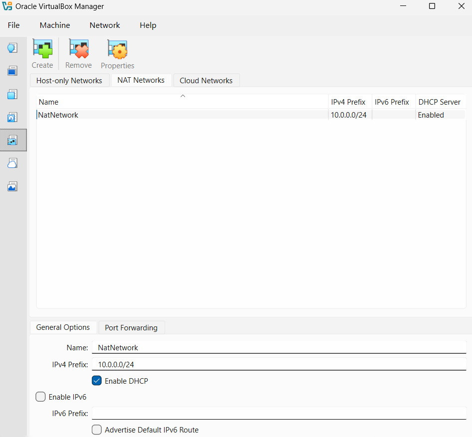
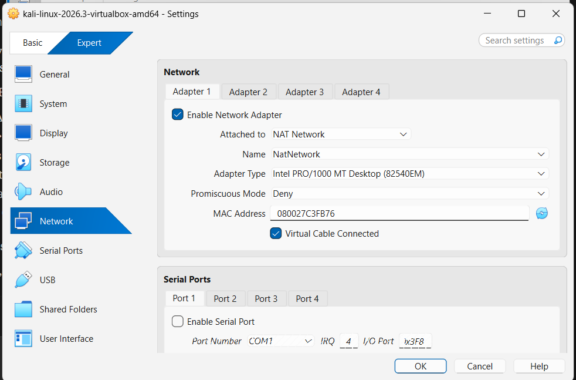
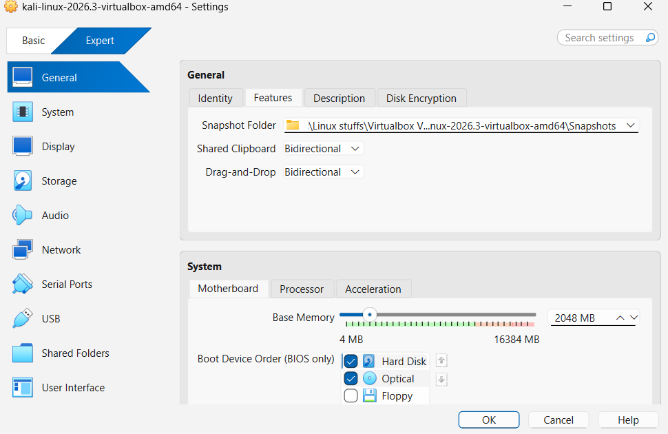
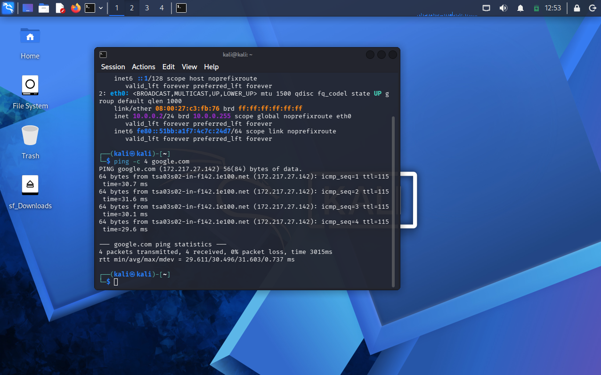
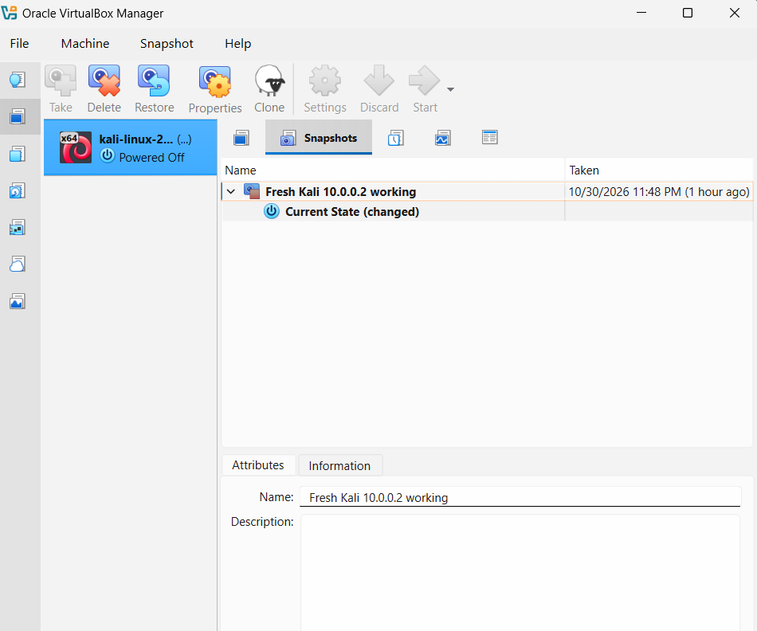

# WK1-PM1: Cybersecurity Lab Setup (VirtualBox + Kali Linux)

Networkwalks Academy · Batch B084 · Week 1 Project

## Task
Set up a cybersecurity testing lab with:
- VirtualBox (latest recommended version) as the base
- Kali Linux as the attacking machine
- NAT Network on subnet `10.0.0.0/24`
- Clipboard and drag/drop enabled
- Shared folder with host Downloads
- Kali static IP `10.0.0.2/24`
- Full internet access on Kali

## Lab Specs
| Item | Value |
|---|---|
| Hypervisor | VirtualBox 7.2.22 |
| Guest OS | Kali Linux 2026.3 (VirtualBox amd64 image) |
| Network | NAT Network `NatNetwork` – `10.0.0.0/24`, DHCP enabled |
| Kali IP | `10.0.0.2/24` |
| Gateway | `10.0.0.1` |
| DNS | `8.8.8.8` |
| Kali RAM | 2048 MB |

## Setup Steps
1. Installed **7-Zip** to extract the Kali `.7z` image.
2. Installed **VirtualBox 7.2.22** in the default `C:\Program Files` location.
3. Set the **Default Machine Folder** to the D: drive to save space on C:.
4. Created the **NAT Network** (File → Tools → Network → NAT Networks) and changed the prefix from `10.0.2.0/24` to `10.0.0.0/24`.
5. Downloaded the **Kali VirtualBox image** from kali.org, extracted it with 7-Zip, and imported the `.vbox` file.
6. Configured the Kali VM:
   - **General → Features:** Shared Clipboard and Drag-and-Drop → Bidirectional
   - **Network → Adapter 1:** NAT Network → NatNetwork
   - **Shared Folders:** host Downloads folder, auto-mount, full access
7. Set the static IP inside Kali using `nmcli`.
8. Verified IP, internet access, and shared folder.
9. Took a **snapshot** of the working state.

## Commands Used

```bash
# List network connections
nmcli connection show

# Set static IP, gateway and DNS
sudo nmcli connection modify "Wired connection 1" ipv4.method manual ipv4.addresses 10.0.0.2/24 ipv4.gateway 10.0.0.1 ipv4.dns 8.8.8.8

# Disable Duplicate Address Detection (fixes connection failure on VirtualBox 7 / Kali 2026)
sudo nmcli connection modify "Wired connection 1" ipv4.dad-timeout 0

# Restart the connection to apply changes
sudo nmcli connection down "Wired connection 1"
sudo nmcli connection up "Wired connection 1"

# Give the kali user access to shared folders
sudo usermod -aG vboxsf kali
sudo reboot

# Verify
ip a                    # check IP is 10.0.0.2/24
ping -c 4 google.com    # check internet + DNS
ls /media/sf_Downloads  # check shared folder
```

## Proof

### 1. NAT Network – 10.0.0.0/24
NatNetwork created with IPv4 prefix `10.0.0.0/24` and DHCP enabled.



### 2. Kali Network Adapter
Adapter 1 attached to **NAT Network → NatNetwork**, cable connected.



### 3. Clipboard & Drag-and-Drop
Both set to **Bidirectional**.



### 4. Static IP, Internet Access & Shared Folder
- `ip a` shows `eth0` with **10.0.0.2/24**
- `ping -c 4 google.com` → 4 packets sent, 4 received, **0% packet loss**
- `sf_Downloads` is mounted on the desktop (shared host Downloads folder)



### 5. Snapshot
Snapshot **"Fresh Kali 10.0.0.2 working"** saved as a clean restore point.



## Issues & Fixes
| Issue | Fix |
|---|---|
| Installer showed "Invalid installation directory" when installing to D: | VirtualBox requires a secure folder. Installed to default `C:\Program Files` and kept VMs on D: via Default Machine Folder |
| "Missing Dependencies" warning for Python bindings | Skipped. Only needed for scripting the VirtualBox API |
| Network tool missing from File → Tools | Switched Preferences to **Expert** mode |
| No "Advanced" tab for clipboard settings | In VirtualBox 7.2 it's renamed **Features** |
| `nmcli connection up` failed after setting static IP | Set `ipv4.dad-timeout 0`, then restarted the connection |

## What I Learned
- How a NAT Network lets VMs share a private subnet while still reaching the internet
- Setting a static IP from the command line with `nmcli`
- Why Duplicate Address Detection can block a connection in virtual networks
- Using snapshots to save a clean, working VM state